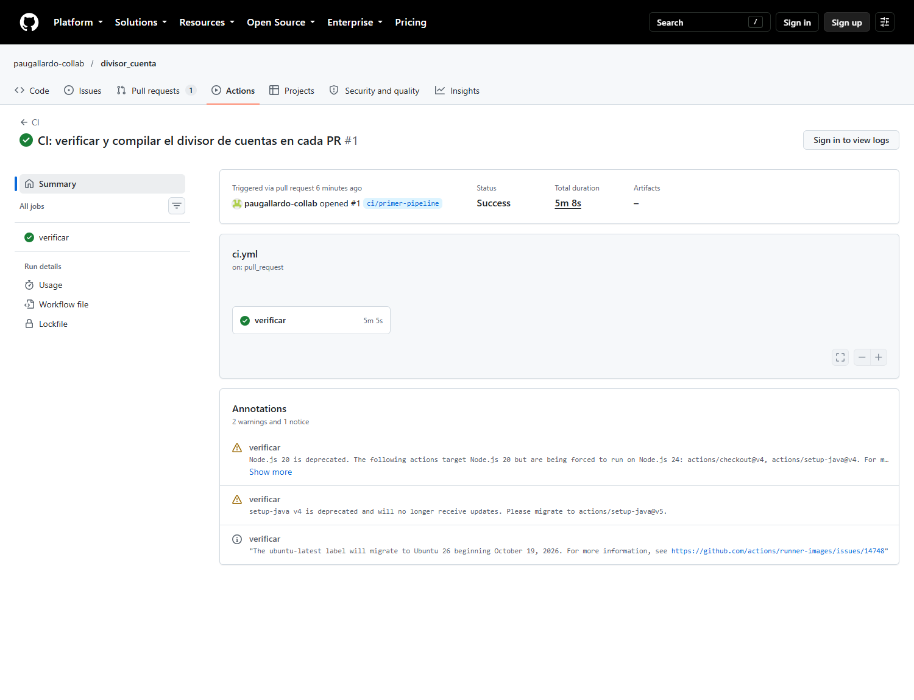
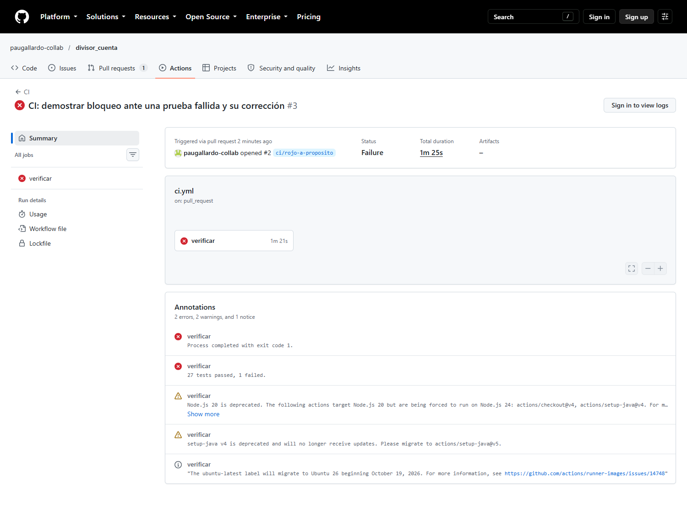
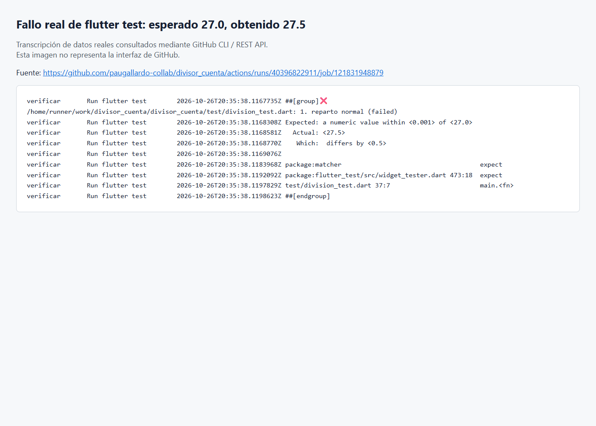
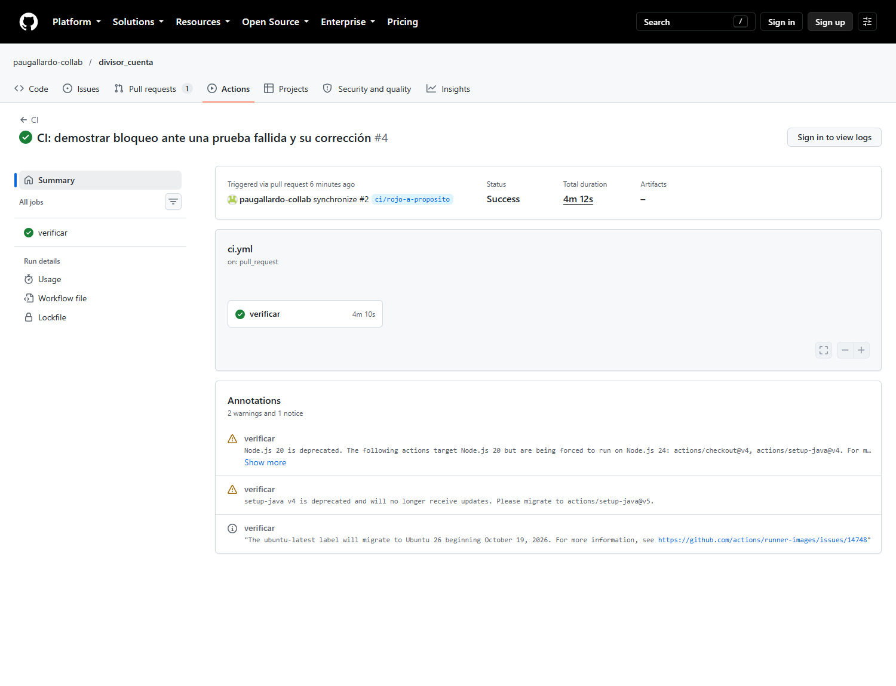
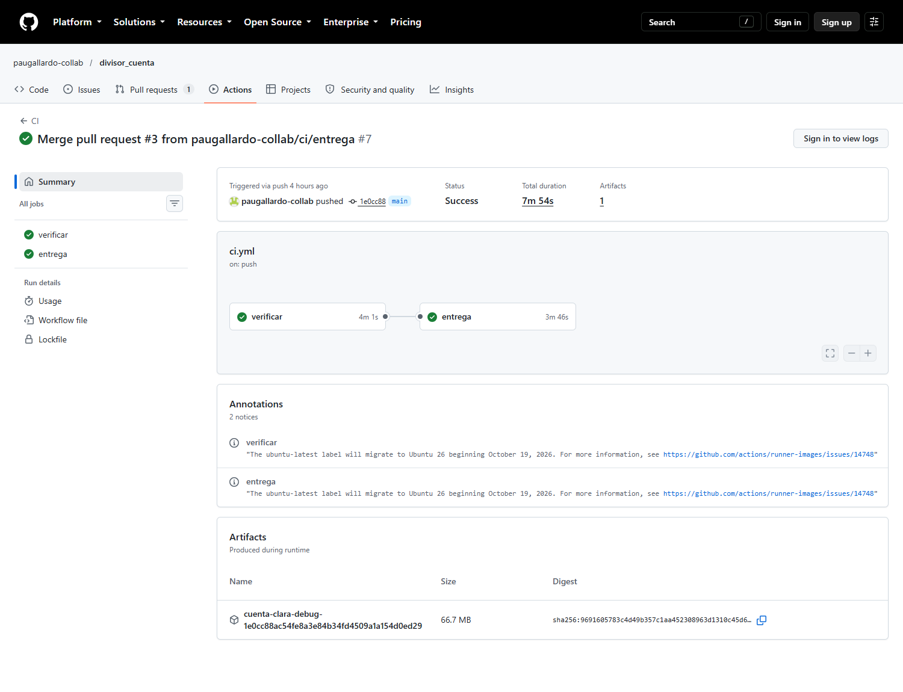
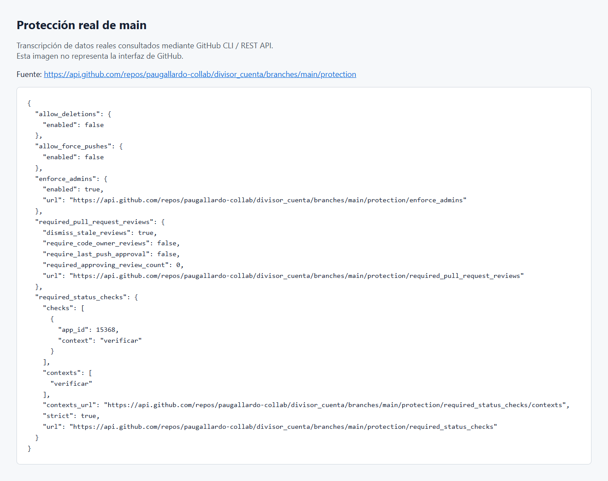
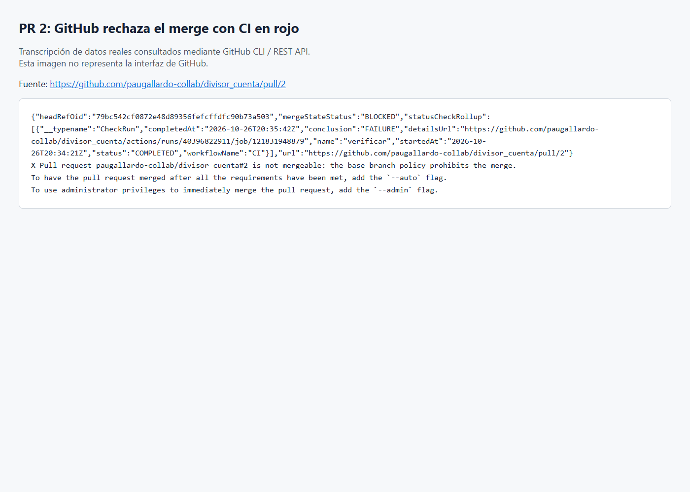

# Cuenta Clara: integración y entrega continua

Se reutiliza el divisor de cuentas de las Semanas 7 y 8, con sus 28 pruebas; la lógica de la app no cambió. El experimento rojo y verde está en el [mismo PR #2](https://github.com/paugallardo-collab/divisor_cuenta/pull/2). Las respuestas anteriores de SDD se conservaron en [docs/respuestas-sdd.md](docs/respuestas-sdd.md).

## 1. Workflow y pasos

```yaml
name: CI

on:
  push:
    branches: [main]
  pull_request:

permissions:
  contents: read

jobs:
  verificar:
    runs-on: ubuntu-latest
    timeout-minutes: 30
    outputs:
      flutter-version: ${{ steps.flutter.outputs.VERSION }}
    steps:
      - uses: actions/checkout@3d3c42e5aac5ba805825da76410c181273ba90b1 # v7.0.1
        with:
          persist-credentials: false
      - uses: actions/setup-java@b843ebf9b913146b38da2eaa7aeddf76074ae1ad # v6.1.0
        with:
          distribution: temurin
          java-version: '17'
      - uses: subosito/flutter-action@1a449444c387b1966244ae4d4f8c696479add0b2 # v2
        id: flutter
        with:
          channel: stable
      - run: flutter pub get
      - run: flutter analyze
      - run: flutter test
      - run: flutter build apk --debug

  entrega:
    needs: verificar
    if: github.event_name == 'push' && github.ref == 'refs/heads/main'
    runs-on: ubuntu-latest
    timeout-minutes: 30
    steps:
      - uses: actions/checkout@3d3c42e5aac5ba805825da76410c181273ba90b1 # v7.0.1
        with:
          persist-credentials: false
      - uses: actions/setup-java@b843ebf9b913146b38da2eaa7aeddf76074ae1ad # v6.1.0
        with:
          distribution: temurin
          java-version: '17'
      - uses: subosito/flutter-action@1a449444c387b1966244ae4d4f8c696479add0b2 # v2
        with:
          channel: stable
          flutter-version: ${{ needs.verificar.outputs.flutter-version }}
      - run: flutter pub get
      - run: flutter build apk --debug
      - uses: actions/upload-artifact@cf430e030ddbb5b0abf93d22962f4752f3646cd9 # v7.0.2
        with:
          name: cuenta-clara-debug-${{ github.sha }}
          path: build/app/outputs/flutter-apk/app-debug.apk
          if-no-files-found: error
          retention-days: 30
```

- `pub get`: instala las dependencias del proyecto.
- `analyze`: revisa errores y advertencias estáticas del código Dart.
- `test`: ejecuta las pruebas de dominio y de interfaz; un fallo detiene el job.
- `build`: compila y empaqueta el APK de depuración para Android.

`verificar` se ejecuta en cada PR y push a main. `entrega` necesita que pase `verificar`, solo corre en push a main y recompila el APK en su propio runner; los jobs no comparten archivos. Reutiliza la versión de Flutter elegida por CI y publica el APK como artifact durante 30 días.



## 2. Fallo intencional y línea exacta

Cambié únicamente la expectativa del escenario «1. reparto normal» de `27.50` a `27.00`. [El run rojo](https://github.com/paugallardo-collab/divisor_cuenta/actions/runs/40396822911) falló en `flutter test` con:

```text
Expected: a numeric value within <0.001> of <27.0>
  Actual: <27.5>
   Which: differs by <0.5>
test/division_test.dart 37:7  main.<fn>
```

Esto identifica la aserción y la diferencia exacta. El escenario está definido en `test/casos_de_prueba.dart`. Restauré `27.50` en la misma rama: [el siguiente run pasó](https://github.com/paugallardo-collab/divisor_cuenta/actions/runs/40397320779) y el PR se fusionó después de quedar verde.







## 3. CI, entrega continua y despliegue continuo

CI ejecuta las verificaciones al integrar cambios. Entrega continua deja un artefacto disponible después de pasar las verificaciones; publicar una versión de producción sigue requiriendo una decisión. Despliegue continuo automatiza también la publicación en producción.

Implementé CI y una introducción a entrega continua: el APK queda como artifact después de verificar main. Es un APK de depuración, sin firma de release ni preparación para usuarios finales; no implementé despliegue continuo.

[Run de entrega y artifact](https://github.com/paugallardo-collab/divisor_cuenta/actions/runs/40398847962).



## 4. Merge bloqueado y protección de main

`main` exige un PR, que la rama esté al día y que el check `verificar` de GitHub Actions pase. La regla también aplica al administrador. Así el fallo cubierto por estas verificaciones no llega a main mediante un push directo ni un merge normal con CI rojo.

Con la prueba incorrecta, la API devolvió `mergeStateStatus: BLOCKED` y `verificar: FAILURE`. Además, un intento real de merge fue rechazado con `the base branch policy prohibits the merge`. Después de restaurar la prueba, CI pasó y se permitió el merge.





**Procedencia de estas dos imágenes:** son transcripciones de respuestas auténticas de GitHub API/CLI, identificadas dentro de la imagen. No son capturas de Settings ni del botón de merge. Las capturas de esa interfaz autenticada siguen pendientes; consulta [PENDIENTES_CAPTURAS.md](PENDIENTES_CAPTURAS.md). Los datos originales se conservan en JSON y TXT junto a las imágenes.

## 5. Revisión crítica del agente

El agente detectó acciones obsoletas, etiquetas móviles, credenciales Git persistidas por defecto, cambios posibles del entorno y el aislamiento de los jobs. Acepté actualizar las acciones verificadas a Node.js 24, fijarlas por SHA, usar permisos de lectura, desactivar la persistencia de credenciales, limitar la duración y fallar si no existe el APK.

No adopté fijar Ubuntu y Flutter entre todos los runs porque la consigna pide `ubuntu-latest` y Flutter estable. Dentro del mismo run, entrega sí usa la versión que pasó CI. No agregué escáneres o acciones de procedencia no comprobada ni un despliegue a producción. Los riesgos restantes y las fuentes están en [revision-ci.md](revision-ci.md).

## 6. Alcance de un CI verde

Un CI verde confirma que el análisis, las pruebas configuradas y la compilación pasaron para ese código y entorno. No garantiza una app sin errores ni sin vulnerabilidades; tampoco demuestra requisitos que nadie convirtió en pruebas.

Por ejemplo, el teclado podría tapar el botón de calcular en un modelo de teléfono que no probamos. Las pruebas actuales y la compilación podrían pasar sin detectar ese problema. La revisión del diff y las pruebas en dispositivos siguen siendo necesarias.

## 7. Qué detectó el pipeline que no había visto

El runner avisó que checkout v4 y setup-java v4 usaban Node.js 20, y que setup-java v4 ya no recibía actualizaciones. Eso no apareció en `flutter analyze` ni en las 28 pruebas locales porque se refiere a la automatización de GitHub. Las acciones se actualizaron y se verificó su runtime Node.js 24 en sus repositorios oficiales. El primer run también avisó de la migración de `ubuntu-latest`, otro cambio externo a la lógica de la app.

El fallo intencional confirmó, por separado, que una expectativa equivocada se detecta y bloquea la integración. No lo presento como un error de la app descubierto por sorpresa.
